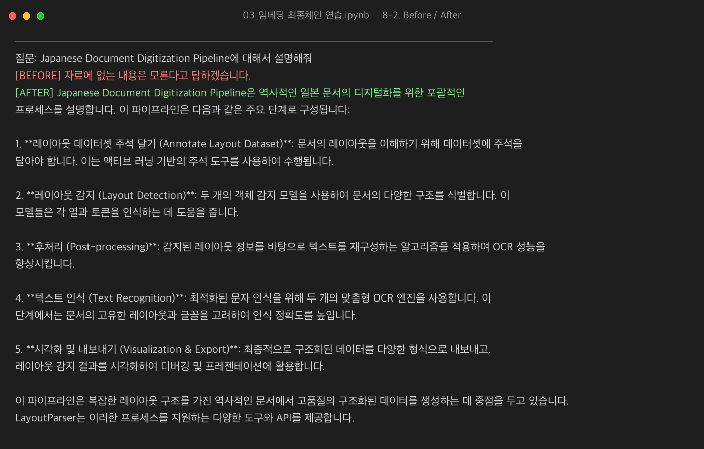
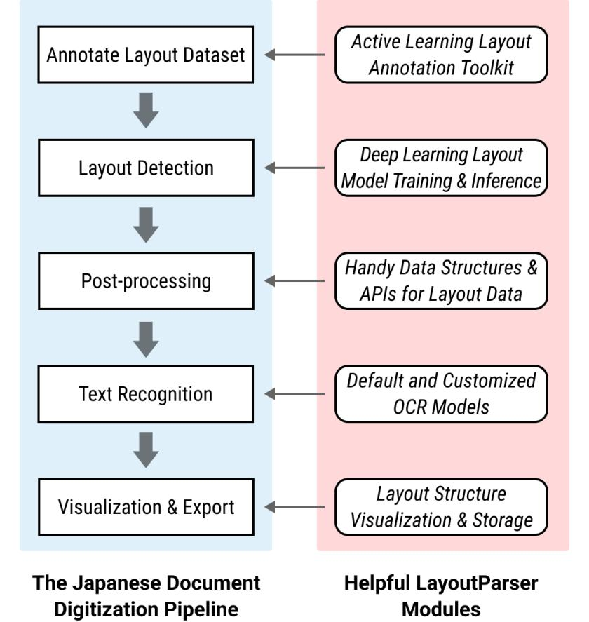
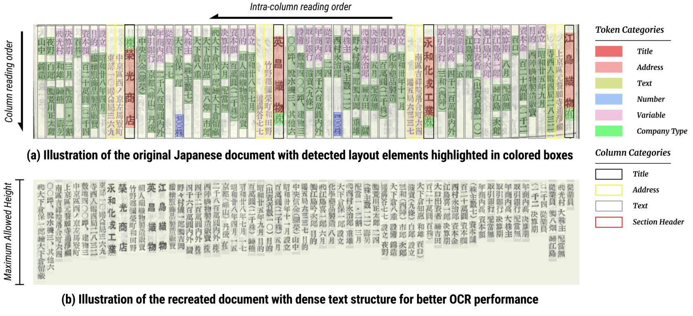
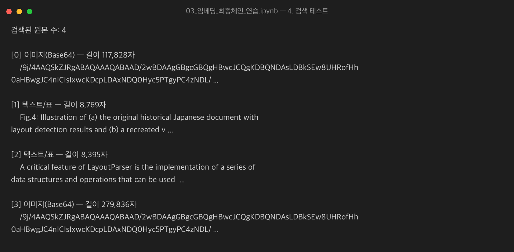
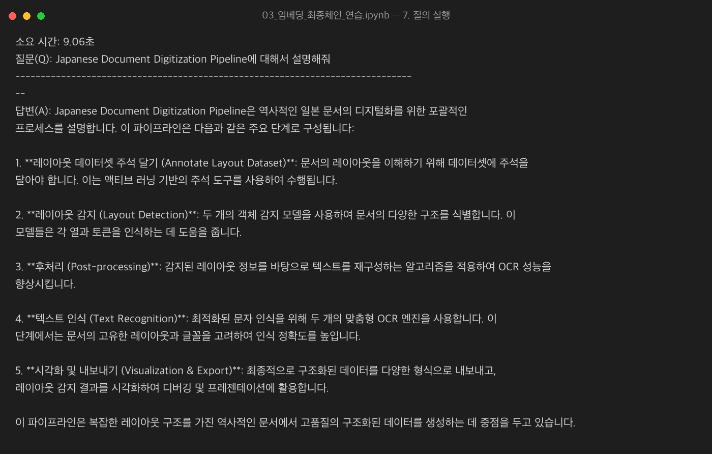

# 📄 Multimodal RAG — PDF 속 텍스트·표·이미지를 모두 이해하는 질의응답

PDF 문서에서 **텍스트 · 표 · 이미지**를 추출해 요약 → 임베딩 → 검색하고, **멀티모달 LLM(GPT-4o-mini)** 이 원본 이미지를 직접 보고 답변하는 RAG 파이프라인입니다.
텍스트만 쓰는 기존 RAG와 **같은 질문**을 던져, 이미지를 이해하는지 여부에 따라 답변이 어떻게 달라지는지 비교했습니다.

---

## 🔥 핵심 결과 — 텍스트 전용 RAG vs 멀티모달 RAG

**질문:** `Japanese Document Digitization Pipeline에 대해서 설명해줘`
(해당 내용은 논문 본문 텍스트가 아니라 **다이어그램 이미지(Fig.)에만** 담겨 있습니다.)

| 구분 | 답변 |
| --- | --- |
| ❌ **Before** (텍스트 전용 RAG) | "자료에 없는 내용은 모른다고 답하겠습니다." |
| ✅ **After** (멀티모달 RAG) | 이미지 속 5단계(Annotate Layout Dataset → Layout Detection → Post-processing → Text Recognition → Visualization & Export)를 정확히 설명 |



### 왜 답변이 달라졌나?

검색 단계에서 멀티모달 RAG는 아래 **원본 이미지**를 찾아 LLM에 그대로 전달했습니다. 텍스트 전용 RAG는 이 그림을 볼 수 없기 때문에 "모른다"고 답할 수밖에 없습니다.

<p align="center">
  
  
</p>

> 왼쪽 그림의 5단계 흐름이 곧 After 답변의 1~5번 항목과 일치합니다.

---

## 🧠 아키텍처

```
          ┌───────────────  색인 단계 (1회)  ───────────────┐
PDF ─▶ 텍스트 / 표 / 이미지 추출 ─▶ 각각 요약(색인 카드) ─▶ 임베딩 ─▶ Chroma (벡터 DB)
                    │                                                  ▲
                    └──── 원본(텍스트·표·Base64 이미지) ─▶ InMemoryStore ┘  (같은 doc_id로 연결)

          ┌───────────────  질의 단계  ───────────────┐
질문 ─▶ 요약으로 유사도 검색 ─▶ doc_id로 원본 꺼내기 ─▶ 이미지/텍스트 분리 ─▶ GPT-4o-mini ─▶ 답변
```

핵심 아이디어는 **Multi-Vector Retriever**: *검색은 요약으로, 답변은 원본으로* 합니다.

| 구성 요소 | 역할 |
| --- | --- |
| `Chroma` (vectorstore) | 요약문 임베딩 저장 → **검색** |
| `InMemoryStore` (docstore) | 원본 텍스트·표·Base64 이미지 저장 → **전달** |
| `doc_id` (id_key) | 요약과 원본을 연결하는 공통 키 |

---

## 🔍 작업 내용 (03_임베딩_최종체인_연습.ipynb)

1. **결과 복원** — 앞 단계(추출·요약)에서 저장한 텍스트/표/이미지 원본과 요약문 로드
2. **검색기 생성** — `MultiVectorRetriever` + `Chroma` + `InMemoryStore`, 임베딩은 `text-embedding-3-small`
3. **요약·원본 짝짓기** — 같은 `uuid` 를 붙여 요약은 벡터 DB에, 원본은 docstore에 저장 (요약 14건 색인)
4. **검색 테스트** — 요약으로 검색했는데 이미지 원본(Base64)이 반환되는지 확인
5. **결과 분리** — Base64 정규식으로 이미지/텍스트를 나눠 멀티모달 메시지 형태로 조립
6. **최종 체인(LCEL)** — `retriever | split | img_prompt_func | gpt-4o-mini | StrOutputParser`
7. **Before/After 비교** — 이미지·표를 뺀 텍스트 전용 RAG를 동일 조건으로 만들어 비교

### 검색 테스트 결과

질문과 글자가 겹치지 않는 이미지 원본이 요약문을 통해 검색됩니다.



### 멀티모달 체인 답변 (소요 약 9초)



---

## 🛠 기술 스택

- **Orchestration:** LangChain 1.x (LCEL), `langchain-classic` MultiVectorRetriever
- **LLM:** OpenAI `gpt-4o-mini` (멀티모달, temperature=0)
- **Embedding:** OpenAI `text-embedding-3-small`
- **Vector DB:** Chroma
- **PDF 파싱:** `unstructured` (`partition_pdf`)
- **Etc:** Python, Jupyter, python-dotenv, Pillow

## 📁 프로젝트 구조

```
multimodal-rag/
├── notebooks/
│   ├── 01_데이터추출_*.ipynb          # PDF → 텍스트/표/이미지 추출
│   ├── 02_요약생성_학습.ipynb         # 요소별 요약(색인 카드) 생성
│   └── 03_임베딩_최종체인_연습.ipynb  # 검색기 + 최종 체인 + Before/After
├── src/                               # extract.py · summarize.py · retriever.py
├── data/processed/                    # 추출·요약 결과 pickle
├── docs/images/                       # README 결과 이미지
├── requirements.txt
└── .env.example
```

## ▶ 실행 방법

```bash
python -m venv .venv && source .venv/bin/activate
pip install -r requirements.txt
cp .env.example .env        # OPENAI_API_KEY 입력
jupyter lab                 # notebooks/ 의 01 → 02 → 03 순서로 실행
```

## 💡 배운 점

- 요약과 원본에 **같은 `doc_id`** 를 붙여야 검색된 요약을 원본으로 되돌릴 수 있다.
- 요약만으로 답하면 표의 셀 값·그림의 세부 내용이 빠지므로, **검색은 요약 / 생성은 원본**으로 분리해야 한다.
- 텍스트에도 적힌 내용을 물으면 Before/After 차이가 나지 않는다. **이미지에만 있는 정보**를 묻는 질문이어야 멀티모달의 효과가 드러난다.
- `InMemoryStore` 는 커널 종료 시 사라지므로, 서비스화하려면 Chroma 영속 모드·Redis 등 영속 저장소로 교체해야 한다.

## 🚧 개선 아이디어

- 영속 저장소(Redis / Chroma persist)로 교체
- 표(table) 요약 추가 및 표 기반 질문으로 추가 비교 실험
- 영문 답변을 로컬 모델(Ollama `llama3.1:8b`)로 번역하는 체인 통합
- 질문 여러 개로 정량 평가(정답률) 진행
